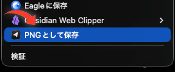

<div align="center">


# 画像をPNGで保存

**Chrome で画像を右クリック → PNG に変換して保存する拡張機能**

[](https://developer.chrome.com/docs/extensions/)
[](https://developer.chrome.com/docs/extensions/mv3/intro/)
[](LICENSE)
[](manifest.json)

**[English](README.md)** | 日本語

---



*▲ 画像を右クリックすると「PNGとして保存」が表示されます*

</div>

## ✨ 機能

| 機能 | 説明 |
|:---|:---|
| 🖼️ PNG 変換保存 | 右クリックした画像を PNG に変換してダウンロード |
| 🎯 コンテキストメニュー | 画像上でのみ「PNGとして保存」メニューを表示 |
| ⚡ 即保存モード | 確認なしでダウンロードフォルダへ直接保存 |
| 📂 保存先選択モード | ダイアログで保存先を都度指定 |
| 💾 設定の永続化 | `chrome.storage.local` でモード設定を保持 |
| 🔢 自動連番 | 同名ファイルは Chrome の `uniquify` で自動リネーム |

## 🚀 インストール

1. このリポジトリをクローンまたはダウンロード

   ```bash
   git clone https://github.com/P0KEBAN/save-image-as-png.git
   ```

2. Chrome で [`chrome://extensions`](chrome://extensions) を開く

3. 右上の **「デベロッパーモード」** を有効化

4. **「パッケージ化されていない拡張機能を読み込む」** をクリック

5. クローンしたフォルダを選択

## 📖 使い方

### 画像を保存する

1. 任意の Web ページで画像を **右クリック**
2. コンテキストメニューから **「PNGとして保存」** を選択
3. 画像が PNG に変換されて保存されます 🎉

### 保存モードを切り替える

拡張機能アイコンをクリックするとポップアップが表示され、2 つのモードを切り替えられます。

> | モード | 動作 |
> |:---|:---|
> | **⚡ 即保存** | 確認なしでダウンロードフォルダへ保存 |
> | **📂 保存先を選択** | 都度ダイアログで保存先を指定 |

## 🏗️ ファイル構成

```
📦 save-image-as-png
├── 📄 manifest.json      # 拡張機能の設定ファイル (Manifest V3)
├── 📄 background.js      # Service Worker / メインロジック
├── 📄 popup.html          # ポップアップ UI
├── 📄 popup.css           # ポップアップのスタイル
├── 📄 popup.js            # ポップアップのロジック
├── 📁 icons/              # 拡張機能アイコン (16/32/48/128px)
├── 📁 lib/                # ライブラリ
└── 📁 docs/               # ドキュメント・スクリーンショット
```

## ⚠️ 注意事項

> [!NOTE]
> 任意サイト上の画像 URL を取得するため、`<all_urls>` の host permission を使用しています。

> [!WARNING]
> 以下のケースは現在サポート対象外です：
> - `blob:` URL の画像
> - CSS 背景画像（`background-image`）

## 🛠️ 技術スタック

- **Chrome Extensions Manifest V3**
- **Service Worker** ベースのバックグラウンド処理
- **Canvas API** による画像→PNG 変換
- **Chrome Downloads API** によるファイル保存
- **Chrome Storage API** による設定管理

## 📄 ライセンス

MIT License © 2025
